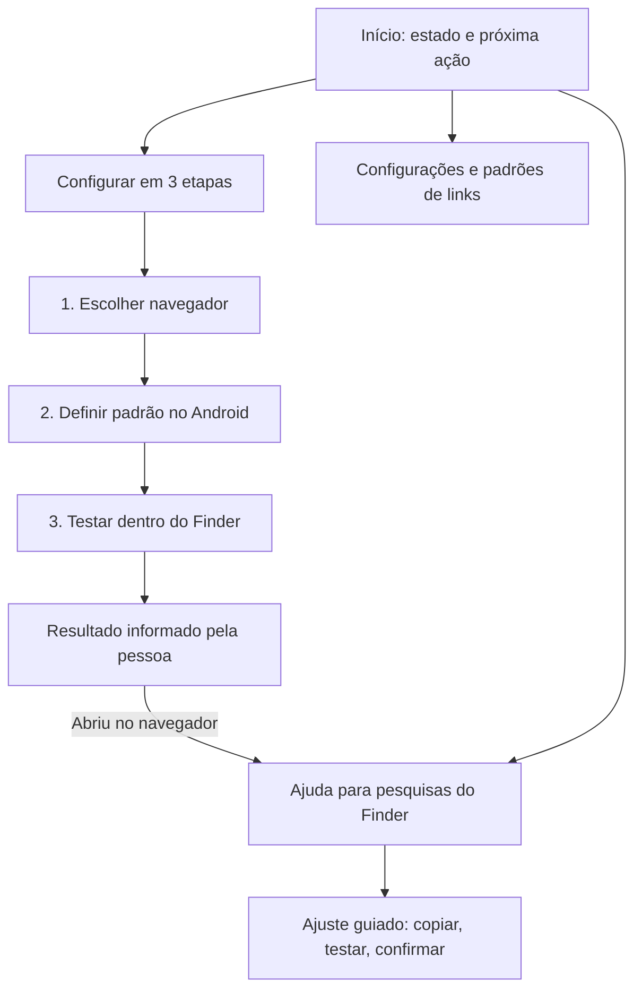

# Plano 0003 — experiência de uso do Finder to Google

Versão 1.1. Base de código: `fd19e6d`, branch `master`, candidato 1.1.0-rc.3/code 4. Pedido: tornar o aplicativo mais simples de entender e operar. Revisão em `0003-ux-ui-user-friendly.revisao.md`. Este documento prepara a execução; a entrega atual é de planejamento.

## 1. Objetivo, evidências e limites

Objetivo: permitir que uma pessoa configure o encaminhamento, teste no Finder e resolva uma mudança de formato do link sem precisar entender Activity, pacote, referrer, client ou assinatura.

Evidências do código atual:

- SettingsActivity reúne configuração, calibração, regras, testes de destino e diagnóstico em uma tela longa. Há sete botões normalmente visíveis, além dos comandos avançados e da sessão pendente.
- Aprender URL aparece antes da ativação no Android, embora startCalibration exija o papel de navegador. A pessoa pode encontrar uma ação que ainda não consegue concluir.
- Testar pesquisa no Google App testa o destino diretamente. A confirmação de envio da Intent não comprova que a pesquisa sugerida do Finder funcionou; essa diferença já gerou confusão nesta conversa.
- A lista de assinaturas apresenta os valores técnicos e abre outro diálogo para ativar/desativar/excluir. Erros de recuperação exibem várias ações com pouca hierarquia.
- O app já usa Material 3, temas claro/escuro, rolagem, insets e conteúdo limitado a 640 dp. Esses recursos devem ser refinados e preservados.

Não há medição de usabilidade, SUS, tempo de tarefa ou captura física da nova experiência. S25/Android 17/One UI 9 foram informados pelo usuário; o funcionamento confirmado anteriormente foi no tablet. Os 84 testes da rc.3 são evidência técnica anterior, não uma medição de UX nem certificação do S25.

Escopo: arquitetura das telas, texto, hierarquia visual, guia de configuração, calibração, regras, ajuda, recuperação e acessibilidade. Manter Kotlin/XML/Material 3, as duas Activities exportadas e os contratos existentes. Fora de escopo: Compose, contas, servidor, analytics, mensagens push, integração remota de regras, publicação em loja, identificação universal da origem e mudança das políticas de roteamento.

## 2. Como medir a melhora

Estabelecer baseline na rc.3 antes de implementar, usando tarefas e dados fictícios. Registrar resultados manualmente fora do app, com identificadores de participantes sem dados pessoais. Não adicionar telemetria, permissões ou histórico de URLs/pesquisas.

| Indicador | Meta proposta | Como verificar |
|---|---|---|
| Configurar e confirmar uma pesquisa real do Finder | Pelo menos 4 de 5 participantes sem ajuda; mediana até 2 minutos | Partir da tela inicial, com Google/navegador instalados. Incluir diálogo Android e troca para Finder; excluir instalação/download do APK |
| Aprender/reativar um padrão | Pelo menos 4 de 5 sem ajuda; mediana até 90 segundos | Navegador padrão já concedido; desativar intencionalmente a regra do aparelho em ambiente de teste |
| Entender onde abrem links comuns | Pelo menos 4 de 5 identificam o navegador em até 10 segundos | Pergunta após ver a tela inicial |
| Encontrar ajuda e lista de padrões | Ajuda em até 2 toques; lista em até 3 | Contar a partir do início |
| Estados enganosos | Zero casos de Ativo após cancelamento ou de sucesso Finder inferido só do teste direto | Testes automatizados e inspeção dos fluxos |
| SUS, escala de 0 a 100 | Alvo de 80 ou mais | Mesmo questionário em português antes/depois; registrar resultado efetivo, não estimar pelo visual |

Cinco participantes são uma rodada exploratória, sem significância estatística. Se houver só o usuário disponível, registrar teste individual e deixar a meta de grupo/SUS sem comprovação. Comparações com os mesmos participantes devem alternar a ordem das tarefas e reconhecer o efeito de aprendizado. Não apagar dados do S25 para criar a baseline: usar instalação/perfil de teste controlado; no aparelho atual, validar atualização preservando preferências.

Usar uma versão brasileira validada do SUS, sem reescrever seus dez itens: respostas de 1 a 5, contribuição dos itens ímpares = resposta menos 1, pares = 5 menos resposta, soma multiplicada por 2,5. E0 deve selecionar e registrar a fonte dessa tradução antes de aplicar o questionário; ela ainda não foi selecionada nesta revisão. O resultado 80 não significa 80% de sucesso. Sem as dez respostas, não calcular score individual; registrar o número de questionários completos. A taxa de conclusão inclui todos que iniciaram a tarefa, inclusive falhas/desistências. Informar tempo dos concluídos com seu n, além da taxa de sucesso, para não esconder falhas na mediana.

## 3. Organização proposta

Três áreas, sem barra de abas obrigatória: **Início**, **Configurações** e **Ajuda**. O guia de configuração e o ajuste do Finder são jornadas abertas a partir dessas áreas. Usar cabeçalho com Voltar e preservar posição/contexto ao retornar.



### 3.1 Início com uma ação principal

Mostrar nome do app, uma frase de propósito, estado do Android e navegador escolhido. O resumo de destino deve dizer: pesquisas reconhecidas podem ir ao Google App; páginas e demais links vão ao navegador escolhido. Não prometer que toda pesquisa do Finder será reconhecida.

Wireframe de conteúdo, não especificação de pixels:

```text
Finder to Google                   Configurações  Ajuda
Pesquisas reconhecidas no Google. Links no seu navegador.

[Estado do encaminhamento no Android]
[Próxima ação explicada em uma frase]
[UMA AÇÃO PRINCIPAL]

Links comuns: Samsung Internet              Alterar
Pesquisas reconhecidas: Google App
```

Prioridade da ação, recalculada em onResume e após cada alteração:

| Condição | Estado/ação principal |
|---|---|
| Sem navegador selecionado ou escolhido indisponível | Escolher navegador / Escolher outro navegador |
| Navegador disponível e papel não concedido | Configurar no Android; se o papel não estiver disponível, orientar configurações do sistema |
| Sessão de calibração ainda ativa e requisitos disponíveis | Continuar teste, com acesso explícito a cancelar |
| Navegador disponível e papel concedido | Configuração do Android concluída; Testar pesquisa do Finder |
| Sessão anterior não mais ativa | Mensagem de teste encerrado e Recomeçar, quando o contexto da jornada estiver disponível |

Navegador ausente/papel perdido prevalecem sobre a sessão pendente. Recalcular com RoleManager/BrowserCatalog reais, não com um booleano de onboarding. Não iniciar uma pesquisa automaticamente ao abrir a tela.

### 3.2 Guia de configuração em três etapas

1. **Escolher navegador:** nome e ícone, com tratamento para ícone ausente. Mostrar pacote apenas em detalhes ou para distinguir nomes iguais. Revalidar a escolha antes de avançar, preservando os critérios HTTP/HTTPS do catálogo.
2. **Definir padrão no Android:** explicar no próprio passo por que o app precisa receber links e que páginas continuarão abrindo no navegador escolhido. Um toque chama o diálogo nativo; eliminar a confirmação própria redundante quando a explicação já estiver visível. Cancelar/retornar deve refletir o estado real. Se o papel já estiver concedido, indicar isso e permitir avançar sem nova solicitação.
3. **Testar no Finder:** instruções curtas para abrir o Finder como a pessoa costuma, pesquisar teste e tocar na sugestão da web. Expor a opção de compatibilidade de forma compreensível e explícita, preservando seu valor anterior e false em instalação nova. Não presumir Intent pública estável para abrir o Finder da Samsung.

Ao voltar, oferecer respostas: Abriu no Google App / Abriu no navegador / Não consegui testar. A primeira é confirmação humana da sessão, sem persistir uma garantia de funcionamento. A segunda leva à ajuda contextual; a terceira mantém a possibilidade de retomar. O botão de teste direto do Google fica na ajuda como Verificar Google App, com aviso de que testa apenas o destino.

Usuários atualizados com configuração pronta entram no início, sem onboarding forçado e sem reinicializar escolhas. O progresso é derivado da configuração existente; página/etapa podem ficar no Bundle, sem URL, consulta ou desafio. Voltar e rotação não repetem concessão de papel, pesquisa ou início de calibração.

### 3.3 Ajuda e calibração guiadas

Entrada principal: **Pesquisa do Finder abre no navegador**. Apresentar a próxima ação de acordo com o que é conhecido, sem prometer diagnóstico automático:

- Papel/navegador ausente: corrigir esse requisito primeiro.
- Compatibilidade desligada: explicar o efeito e oferecer ativação por toque explícito, seguida de novo teste.
- Compatibilidade ligada: oferecer ajuste de reconhecimento e verificação direta do Google como alternativas explicadas. Não assumir que todo erro é assinatura desconhecida.
- Diagnóstico local opcional pode ser copiado para suporte; não analisar o texto traduzido do diagnóstico como fonte de estado estruturado.

Calibração em três passos: **Copiar pesquisa de teste → Testar no Finder → Confirmar padrão encontrado**. Uma instrução curta por passo; explicar a troca para o Finder e o limite de cinco minutos. Exibir a frase para conferência e cópia explícita. Ao voltar/agir, verificar validade; se a sessão acabou ou foi perdida, mostrar Teste encerrado e Recomeçar. Não criar contagem regressiva, serviço ou timer residente.

Na confirmação, usar linguagem simples e permitir ver o identificador técnico completo. Antes de salvar, informar que se reconhece um formato de link, que outro app pode gerar igual e que a compatibilidade será ativada se estiver desligada. Botão Salvar e ativar quando estiver desligada; Salvar padrão quando já estiver ligada. Continuar sem salvar mantém a rota normal, sem prometer um destino específico. Preservar a sessão efêmera, captura única, desafio exato, origem OTHER bloqueada e client único válido.

Revalidar modo, explicação e ação ao retomar a confirmação e no clique. Se o modo mudou desde a apresentação, atualizar o contexto antes de executar uma ativação que não estava informada. O texto Salvar padrão não pode provocar uma ativação invisível.

Sessão pendente e captura aguardando confirmação são estados distintos. A primeira não é restaurada após perda de processo. A segunda pode ser restaurada pelo sistema como na rc.3: somente client validado e metadados permitidos no Bundle, correspondentes ao Intent original, sem copiar URL/desafio nem armar uma sessão nova. Não descartar essa confirmação só porque current() retorna null; nunca repetir Google na restauração. Recomeçar se aplica à espera de captura que deixou de estar ativa.

### 3.4 Padrões de links e diagnóstico avançados

- Trocar o nome visível Assinaturas por **Padrões de links**; preservar as chaves e a semântica dos dados.
- Uma lista com estado ativo, valor identificador e ações acessíveis. Padrões iniciais podem ter rótulo auxiliar Tablet Samsung/Celular Samsung; não afirmar que o app detectou o hardware. O client continua visível como detalhe para distinguir regras. Não introduzir aliases persistidos nesta etapa.
- Ativar/desativar na lista, cadastro manual em formulário com ajuda e erro no campo, excluir com opção Desfazer. Evitar empilhar diálogos para tarefas comuns. Manter limite de 32, comprimento/formato e validação atuais; vazio/lista cheia com orientação acionável.
- Desfazer deve restaurar exatamente client e enabled anteriores, inclusive uma regra desativada. O save atual sempre reativa: não usá-lo isoladamente como undo. Prever restauração atômica no store com controle de capacidade/conflito; se outro comando já recriou a regra, não sobrescrevê-lo silenciosamente. Undo é efêmero e não vira histórico persistido.
- Diagnóstico em Ajuda → Detalhes para suporte. Resumo curto, Copiar e detalhes técnicos expansíveis; continuar opt-in e apagando ao desligar. Não registrar URL, consulta ou desafio.
- Renomear Restaurar navegador anterior para **Mudar navegador padrão do Android**: a função abre configurações e não restaura automaticamente uma escolha anterior.

### 3.5 Recuperação de falhas

Cada erro mostra problema, próxima ação e alternativa secundária. Navegador ausente: Escolher outro; falha de lançamento: Tentar novamente/Escolher outro; limite de repetição: explicar retorno do link e priorizar escolher navegador; entrada inválida: orientação e Fechar, sem tentar encaminhar.

Continuar usando BrowserFailure/SearchFailure tipados. A URI original continua no Intent e o retry preserva o link inteiro. Rotação não refaz Google. Falha Google com navegador aberto não é apresentada como perda do link. Não transformar startActivity aceito em prova de resultados nativos renderizados, nem habilitar diagnóstico para acompanhar o usuário sem ação explícita.

## 4. Direção visual e acessibilidade

- Material 3 com a identidade azul atual, hierarquia consistente: botão preenchido para avanço principal, contornado para alternativa, texto para apoio. Sem novo framework ou redesign de marca.
- Espaçamento em escala 8/16/24 dp. Margens de 16 dp em telefone e 24 dp em telas largas; conteúdo central até 640 dp. Reduzir margens aninhadas que comprimem a leitura. Coluna única para esta etapa.
- Texto principal perto de 16 sp, títulos curtos, ícones acompanhados de texto. Evitar limites de linhas que cortem instruções/ações ao ampliar fonte. Rolagem é aceita e necessária com fonte grande.
- Contraste mínimo 4,5:1 para texto normal, 3:1 para texto grande/componentes; confirmar as cores renderizadas em ambos os temas. Estado sempre por texto/ícone além da cor. Origem desconhecida não é erro vermelho por si só.
- Alvos de toque de pelo menos 48 dp, ordem TalkBack coerente, nomes de ícones, estados dos switches anunciados e foco previsível após erro/navegação. Evitar anúncios repetidos de regiões vivas.
- Testar larguras 320/360/412/600/840 dp, retrato/paisagem, fonte 100/130/200%, recortes, gestos/três botões e teclado aberto no formulário. Não exigir tudo acima da dobra com fonte 200%; em tamanho padrão, a ação principal do início deve ser encontrada sem percorrer uma tela longa.
- Insets aplicados uma vez por raiz, incluindo proteção ao teclado na edição. Não duplicar padding após navegar/rotacionar. Campos efêmeros continuam com salvamento automático desabilitado.

## 5. Execução em etapas

| Etapa | Entrega | Critério de aceite |
|---|---|---|
| E0 — baseline | Preservar rc.3, configurações de teste e medir tarefas atuais | Fatos/hipóteses separados; nenhuma nota SUS inventada |
| E1 — conteúdo/protótipo | Wireframes de início, guia, ajuda/calibração, regras e erro; catálogo de textos | Próxima ação clara em todos os estados da seção 3; sem depender de client/referrer na jornada comum |
| E2 — navegação/guia | Início, Configurações/Ajuda e guia de três etapas | Atualização não impõe onboarding nem altera configurações; cancelamento/Voltar/retorno Android corretos |
| E3 — calibração/regras/recuperação | Passos curtos, lista de padrões, undo e erros contextuais | Efeito imediato, confirmação explícita, restauração de regra exata e nenhum encaminhamento repetido por rotação |
| E4 — acabamento e acessibilidade | Tokens visuais, contraste, tipografia, TalkBack e teclado | Matriz de tamanhos/fonte/temas sem corte de ação ou sobreposição de barras |
| E5 — validar e entregar | Regressão, teste de tarefas, APK candidato, fonte/relatórios/checksum | Resultados registrados; sem anunciar melhora quantitativa/compatibilidade física não medida |

Implementar sequencialmente, validando os estados antes do acabamento. Os wireframes e a revisão dos critérios são parte do trabalho, sem criar uma nova rodada obrigatória de aprovação de cada tela. A prioridade do primeiro candidato é E0–E3; acabamento essencial de acessibilidade e checks de E4/E5 continuam necessários antes de entregá-lo.

## 6. Mapa técnico e contratos

Manter SettingsActivity como entrada e navegação por views XML/componentes internos, com estado explícito de página/etapa; não adicionar Activity exportada para cada passo ou dependência de navegação sem necessidade. Extrair renderização/estado da UI em classes pequenas para evitar uma Activity monolítica. O estado representa fatos reais: navegador escolhido/disponível, papel disponível/concedido, modo e sessão; não é uma segunda política de roteamento.

| Arquivos/área existentes | Trabalho previsto |
|---|---|
| `ui/SettingsActivity.kt`, `ui/UiSupport.kt`, layouts de configuração | Navegação, renderização por estado, guia, seletor e insets |
| `ui/SignatureManager.kt`, `dialog_signature.xml` | Lista/formulário com menos diálogos e mensagens acionáveis |
| `ui/LinkRouterActivity.kt`, layouts de calibração/recuperação | Apresentação de confirmação e erros, mantendo ciclo de vida/despacho |
| `routing/FinderCalibration.kt` | Preservar contrato; expor só o necessário para a UI reconhecer sessão ativa/inativa, sem persistir desafio |
| `data/FinderSignatureStore.kt` | Restauração atômica para undo preservando enabled e limite; mesmo esquema persistido |
| `system/BrowserRoleHelper.kt`, `routing/BrowserCatalog.kt` | Continuam fontes de verdade; ícones na camada UI com fallback por candidato |
| `res/values/strings.xml`, temas/cores/dimensões | Linguagem simples e componentes visuais consistentes |

Preservar `router_settings`: browser_package, browser_component, experimental_finder, diagnostics_enabled e last_diagnostic. Preservar `finder_rules`: registered e disabled. Não renomear/remigrar dados para acompanhar rótulos; não repovoar regras excluídas e não habilitar compatibilidade/diagnóstico silenciosamente. Nenhum reset de configurações, URL/termo em novo estado salvo ou leitura do clipboard para inferir intenção.

Política/parser/BrowserForwarder/guard continuam funcionalmente iguais: origem verificável de outro app → navegador; desconhecida só usa regras ativas em compatibilidade; hosts, caminho, validação, limites e encaminhamento explícito preservados. Manter manifest, queries e backup; sem INTERNET, root, serviços, timers residentes, analytics ou novas permissões.

## 7. Validação necessária durante a implementação

- Preservar a cobertura dos 84 testes existentes, atualizando referências de UI quando necessário. Acrescentar testes de transição/navegação, não apenas de texto ou cor.
- Novo teste de estado do início: não configurado, navegador removido, papel negado/retirado/indisponível, pronto, calibração ativa e contexto encerrado. Estado não confunde papel padrão, configuração e busca efetivamente vista.
- `ActivityRecoveryTest`/`CalibrationUiTest`: Voltar/rotacionar/trocar de app, cancelamento Android, nenhuma pesquisa ao abrir o início, opt-ins preservados, copiar/iniciar somente no toque, confirmação e descarte, sessão encerrada com nova tentativa explícita.
- Cobrir retorno à confirmação após o modo mudar em outra tela: rótulo/explicação refletem o valor atual e nenhum Salvar padrão reativa silenciosamente. Distinguir perda da sessão pendente de confirmação de candidato restaurada com estado válido; só um clique novo pode salvar e encaminhar.
- `FinderSignatureStoreTest`: undo de regra antes ativa/desativada, capacidade cheia, conflito com outra alteração, remoção completa e reinício. `FinderCalibrationTest` mantém desafio/prazo/origem/duplicatas.
- `AppPreferencesTest` e teste de atualização rc.3 → candidato: navegador, modo, diagnóstico e regras idênticos; usuários configurados não precisam refazer setup. Remover dados só em ambiente de teste controlado.
- Manter política, parser, fallback, guard e clipboard cobertos pelos testes existentes. Verificar ausência de consulta/URL em estado novo, preferências, suporte e exportações.
- Inspeção visual/TalkBack/teclado e tarefas reais em S25 Android 17/One UI 9 e tablet quando disponíveis. Robolectric não substitui esse resultado.

```sh
python3 scripts/check_project.py
./gradlew testDebugUnitTest lintDebug assembleDebug assembleDebugAndroidTest
git diff --check
git diff --cached --check
# Com variáveis privadas FINDER_RELEASE_* configuradas:
./gradlew lintRelease assembleRelease
# Somente com dispositivo/emulador pronto, para a variante debug:
./gradlew connectedDebugAndroidTest
```

Registrar testes executados versus pendentes. Conferir manifest/certificados/checksums e smoke do release minificado exato quando houver runtime utilizável. Medir novamente as tarefas e SUS; se metas de grupo não puderem ser medidas, declarar isso e não publicar um índice fictício.

## 8. Atualização, retorno e conclusão

Próximo candidato: 1.1.0-rc.4, versionCode 5 se nenhum outro APK tiver sido entregue antes; conferir metadados e aumentar novamente se necessário. Mesmo applicationId e respectivos certificados. Debug atualiza debug sem desinstalar; release atualiza release. Sem troca de chave ou desinstalação automática. Guardar rc.3 e fonte antes de alterar.

Se houver regressão, produzir nova compilação da base estável com certificado correspondente e versionCode superior; não prometer downgrade instalável por cima. Não deletar os arquivos de preferências. Qualquer dado adicional puramente visual deve ser opcional e não impedir o código anterior de ler configurações.

Entregar atualização debug e release candidato com checksums, fonte/relatórios separados e arquivos privados sem credenciais no canal já usado, após verificar uploads. Identificar versão exata e resultados do teste físico. Final 1.1.0 exige ainda QA do release, compatibilidade real e guarda durável da chave já pendentes dos planos anteriores. Plano executável não equivale a validação de usabilidade concluída.
